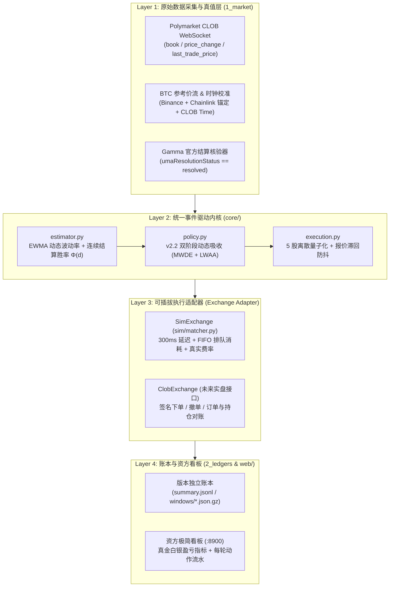

# PM-Quant 总体设计与工程规划 (`v2.2`)

## 1. 总体目标

构建一套面向 **Polymarket BTC 5 分钟二元期权市场**的真实、精简、可证伪的量化实验与（未来）实盘交易系统，三条准绳：

1. **真实性第一**：严禁用合成假数据或过于宽松的成交假设（触价即成交、忽略排队深度、忽略逆向选择）伪造账面盈利。开盘基准价、盘口事件流、成交队列消耗、手续费率与最终胜负结算，必须严格对齐 Polymarket 官方 CLOB 与 Chainlink / Gamma 结算真值。
2. **极简可维护**：全系统采用单一事件驱动内核，回放（Replay）、纸面（Paper）、实盘（Live）共用同一个决策与执行状态机，仅替换底层交易所适配器。吸取旧工程“在未验证基础优势前层层堆叠补丁、导致上千行状态分支难以维护”的教训，拒绝零散分支。
3. **以持续盈利验证为唯一准绳**：任何策略参数或逻辑修改，必须在真实录制的样本外历史事件流中证明净期望大于 0，并通过向前纸面验证，才允许放大仓位。

## 2. 版本与数据治理

采用语义化版本 `v<Major>.<Minor>`。主版本（如 `v2.0`）对应核心架构升级、概率/效用模型重构或从纸面切换至实盘引擎；次版本（如 `v2.1`、`v2.2`）对应策略参数调整、撮合队列校准与报价阈值优化。每次变更策略行为、撮合规则或核心参数，必须递增版本号并生成独立账本 `data/2_ledgers/<VERSION>/`，严禁混写或污染历史成绩。执行 `python main.py seal` 自动将该版本的 `config.py` 与 `core/` 打包为 `code_snapshot.zip`，并生成含参数快照的 `manifest.json`。

数据按四层冷热分离存放于 `data/`：`1_market/` 是只读、只追加的原始市场录制资产（`events/` 盘口与成交流、`oracle/` Chainlink/Binance 秒级参考价与窗口锚定开盘价、`settlements/` Gamma/UMA 官方结算真值）；`2_ledgers/` 是按版本隔离的运行账本（`live.json` 当前窗口实时状态、`summary.jsonl` 已结算窗口单行汇总、`windows/*.json.gz` 单窗完整轨迹归档、`manifest.json` 与 `code_snapshot.zip` 封存元数据）；`3_reports/` 是研究层校准与压力测试报告；`4_runtime/` 是进程 PID 与运行日志。

## 3. 核心架构（5 层）

### 3.1 关键工程设计

1. **报价滞回防抖**：在场挂单与理想报价差距 `< 2 ticks`（`< $0.02`）且仍具正安全垫时保持原挂单不动，绝不为 1 档噪音放弃排队优先级；轻度观望但未触发毒性冲击时保留深价安全挂单。
2. **FIFO 排队与成交流驱动**：挂单在 `placed_at + LATENCY_S` 后生效，按当时同价位挂单深度初始化 `queue_ahead`，仅当真实市场成交发生在挂单价或更优价时扣减队列，队列耗尽才触发部分或全部成交。两个互补 token 盘口在决策与撮合前先做无套利一致性校正（`ask_up + ask_down ≥ 1.00`、`bid_up + bid_down ≤ 1.00`），杜绝把低于 $1 的配对当成无风险利润。
3. **真值与官方预言机对齐**：开盘基准优先直连 Polymarket 官方 Chainlink BTC/USD 60s TWAP，异常时回退币安现货，杜绝跨所基差脱节；窗口结算胜负由 Gamma API 已完成结算（`umaResolutionStatus == "resolved"` 且 `outcomePrices` 为 `[0, 1]`）双重校验为权威真值。
4. **动态波动率与手续费**：由实时现货序列滚动计算 `realized_vol_bps` 替代静态写死；按官方 maker/taker 费率计净收益（吃单 `费率 × p × (1-p)`，挂单零费率）。
5. **财务口径隔离**：可用资金 = 初始本金 $100 + 累计已结算净收益；看板统一北京时间（UTC+8）展示轮次区间。`net_pnl = 结算兑现 proceeds − 两腿总成本 total_cost`，`pair_cost = Up 均价 + Down 均价`，只有 `pair_cost > 1.00` 的补腿计入 `insurance_paid`。
6. **测试环境隔离**：所有单元测试强制使用 `tempfile.TemporaryDirectory()`，严禁向正式账本写入任何测试记录。

## 4. 当前状态与路线图

**已完成**：真实数据基建与事件驱动内核重构；FIFO 队列撮合与报价滞回；确定性历史回放器与资方极简看板；v2.2 双阶段动态吸收策略（MWDE 顺势低吸 + LWAA 尾盘高确信吸收，单腿持有到期，仅在 `pair_cost ≤ 1.00` 时补腿锁定无风险配对）。

**当前定位**：一个可审计的研究/纸面交易框架，而非已被验证的正期望策略。早期被动双边做市路线经事件驱动回放验证无统计正期望，v2.2 转向定向吸收；任何实盘或加仓决定，都必须等到新的回放/向前纸面在同一套费用、深度、排队假设下给出显著为正的期望。

**待过关标准**：
- **样本外优势验证**：在悲观排队与真实手续费口径下，单窗口净收益均值置信区间下界 `> 0`。若不满足，直接在模型层修正入场条件，绝不堆砌零散补丁。
- **向前纸面验证**：冻结参数在实时流上连续运行，净收益、配对率、单窗最大亏损与回放预期一致，无单腿失控敞口。
- **小额实盘校准**：编写 `ClobExchange` 实盘适配器（EIP-712 签名下单、撤单、WebSocket 成交回执、持仓对账、单日/单窗硬熔断），以最小单量（5 股）核对真实成交率与模拟撮合的偏差，确认一致后再按风控阶梯放大。
