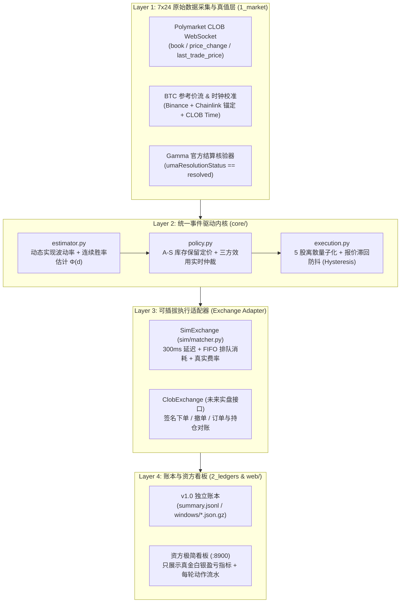

# PM-Quant Master Design & Engineering Plan (`v1.0`)

## 1. 总体目标（Overall Objective）

构建一套面向 **Polymarket BTC 5 分钟二元期权市场**的真实、精简、可证伪的量化实验与实盘交易系统：

1. **真实性第一（Realism over Synthetic Toy Models）**：
   - 严禁用合成假数据或过于宽松的成交假设（如触价即成交、忽略排队深度、忽略逆向选择）来伪造账面盈利。
   - 开盘基准价、盘口事件流、成交队列消耗、手续费率、以及最终胜负结算必须严格对齐 Polymarket 官方 CLOB 与 Chainlink / Gamma 结算真值。
2. **极简可维护架构（Zero Legacy Bloat）**：
   - 吸取旧工程（V32~V48）“在未验证基础优势的情况下层层堆叠补丁、导致上千行状态分支难以维护”的教训。
   - 全系统采用**单一事件驱动内核（Single Event-Driven Kernel）**：回放（Replay）、纸面（Paper）、实盘（Live）100% 共用同一个 `on_event` 决策与执行状态机，仅替换底层交易所适配器（`SimExchange` vs `ClobExchange`）。
3. **以持续盈利验证为唯一准绳（Edge-First Validation）**：
   - 任何策略参数或逻辑修改必须在**真实录制的样本外历史事件流**中证明净期望大于 0，并通过向前纸面验证与小额实盘校准，才允许放大仓位。

---

## 2. 版本与数据治理规范（Versioning & Data Governance）

### 2.1 语义化版本号（Semantic Versioning）
摒弃旧式的 `v1_r1` 命名，统一采用专业语义化版本 **`v<Major>.<Minor>`**：

| 版本级别 | 格式示例 | 触发条件 | 账本路径 |
|---|---|---|---|
| **主版本（Major）** | `v1.0`, `v2.0` | 核心架构升级、概率/效用模型重构、或从纸面切换至实盘引擎 | `data/2_ledgers/v1.0/` |
| **次版本（Minor）** | `v1.1`, `v1.2` | 策略参数调整、撮合队列参数校准、报价滞回阈值优化 | `data/2_ledgers/v1.1/` |

- **严禁混写账本**：每次变更策略行为、撮合规则或核心参数，必须递增版本号并生成独立账本目录。
- **版本封存（Sealing）**：执行 `python main.py seal` 自动将该版本的 `config.py` 与 `core/` 打包为 `code_snapshot.zip`，并生成含参数快照的 `manifest.json`。

### 2.2 四层冷热数据分离（`data/`）
```text
D:\pm-quant\data/
├── 1_market/                 # 【冷数据：只读、只追加】7x24 原始市场录制资产
│   ├── events/               # Polymarket WS 原始流（book, price_change, last_trade_price）
│   ├── oracle/               # Chainlink / Binance BTC 秒级参考价与窗口锚定开盘价
│   └── settlements/          # Gamma / UMA 官方已核验二元结算真值（payouts = [0, 1]）
├── 2_ledgers/                # 【热数据：按版本隔离】各版本独立运行账本
│   └── v1.0/
│       ├── live.json         # 当前窗口实时状态（原子替换写入，供看板秒级读取）
│       ├── summary.jsonl     # 已结算窗口单行汇总流水（只追加，绝不混入单测数据）
│       ├── windows/          # 单窗口完整动作与事件轨迹（.json.gz 压缩归档）
│       ├── manifest.json     # 版本参数与封存元数据
│       └── code_snapshot.zip # 版本代码快照
├── 3_reports/                # 【研究层】校准报告、优势分解、保守/乐观敏感度对比
└── 4_runtime/                # 【运行层】进程 PID、运行日志与健康状态
```

---

## 3. 核心架构设计（5-Layer Architecture）



### 3.1 针对性解决当前核心短板的 5 项设计

1. **解决“每秒改价撤单导致永远排不到队”（报价滞回防抖）**：
   - 在 `core/execution.py` 引入**滞回带（Hysteresis）**：当在场挂单与理想报价差距 `< 2 ticks`（`< $0.02`）且当前价格仍具备正安全垫时，**保持原挂单不动**，绝不为 1 档噪音放弃排队优先级。
   - 当信号进入轻度观望区但未触发毒性冲击（Toxic Shock）时，保留已有深价安全挂单，不每跳盲目撤单。
2. **解决“撮合器脱离真实成交”（FIFO 排队与成交流驱动）**：
   - 废除“只看每秒 REST 快照卖一价是否穿价”的粗糙判定。
   - 接入 `last_trade_price` 成交流与 `sim/matcher.py`：挂单在 `placed_at + LATENCY_S` 后生效，按当时同价位挂单深度初始化 `queue_ahead`，仅当真实市场成交发生在挂单价或更优价时扣减 `queue_ahead`，队列耗尽才触发部分或全部成交。
3. **解决“开盘价与结算判准失真”（真值与官方预言机对齐）**：
   - 市场准入与开盘基准优先直连 Polymarket 官方 `crypto-price` 接口（`https://polymarket.com/api/crypto/crypto-price`），获取官方 Chainlink BTC/USD 60s TWAP 开盘价，仅在异常时回退币安现货，杜绝跨所基差（Oracle Basis）带来的价格脱节；
   - 窗口结算最终胜负由 Polymarket 官方结算接口及 Gamma API 已完成结算（`umaResolutionStatus == "resolved"` 且 `outcomePrices` 为 `[0, 1]`）双重校验为权威真值。
4. **解决“波动率与手续费写死”（动态校准）**：
   - 由实时现货序列滚动计算真实已实现波动率 `realized_vol_bps`，替代静态写死的 `15.0 bps`；
   - 从市场元数据读取实际 `makerBaseFee` / `takerBaseFee` 计算净收益。
5. **解决“资金与收益口径模糊”（财务口径隔离）**：
   - 严格区分并独立展示**可用资金（Available Capital = 初始本金 $100.00 + 累计已结算净收益）**与**周转资金（Turnover Capital = 历史各轮累计成交流水总额）**；
   - 看板统一采用北京时间（UTC+8）展示轮次区间，剔除无意义的 Unix timestamp slug。
6. **解决“测试污染正式账本”（严格环境隔离）**：
   - 所有单元测试强制使用 `tempfile.TemporaryDirectory()`，严禁向 `data/2_ledgers/v1.0/` 写入任何测试记录。

---

## 4. 阶段规划与硬性过关标准（Roadmap & Gates）

### Phase 1：`v1.0` — 真实数据基建与事件驱动内核重构（当前阶段）
- **交付物**：
  1. 统一版本标识为 `v1.0`，清理全部旧实验残留与合成回放脚本；
  2. 实现 Polymarket WebSocket 实时事件流 + BTC 参考价 + Gamma 官方结算录制器（写入 `data/1_market/`）；
  3. 打通 `sim/matcher.py` FIFO 队列撮合与 `runtime/runner.py`，实现报价滞回防抖（Hysteresis）；
  4. 完善确定性历史回放器（`sim/replay.py`）与资方极简看板（`web/`）。
- **过关标准（Gate 1）**：
  - 连续录制真实市场窗口无崩溃，数据缺口可量化，每个已结束窗口均有 Gamma 官方结算核验；
  - 挂单中位存活时间从 1 秒提升至合理排队周期（15s+），纸面撮合能真实反映排队成交与穿价成交。

### Phase 2：`v1.1` — 样本外优势验证与参数校准（Research & Calibration）
- **交付物**：
  1. 在连续录制的真实市场数据集上运行回放，输出《优势分解报告》（`data/3_reports/`）：
     - 检验概率模型 $\Phi(d)$ 相比市场中间价是否具有显著预测增量（Brier Score 对比）；
     - 测量被动成交后的逆向选择成本（Adverse Selection）与配对完成率；
  2. 对排队假设做悲观（100% 队尾）与标准两种敏感度测试。
- **过关标准（Gate 2）**：
  - **硬门槛**：在悲观排队与真实手续费口径下，单窗口净收益均值置信区间下界 $> 0$。若不满足，直接在模型层修正入场条件，绝不堆砌零散补丁。

### Phase 3：`v1.2` — 向前纸面验证（Forward Paper Validation）
- **交付物**：
  - 冻结 `v1.2` 参数，在实盘实时流上连续运行向前纸面测试，看板实时展示每轮具体挂单、补腿对冲、成交均价与净落袋盈亏。
- **过关标准（Gate 3）**：
  - 向前纸面净收益、配对率、单窗口最大亏损与回放预期一致，无单腿失控敞口。

### Phase 4：`v2.0` — 小额实盘校准与正式投产（Live Execution）
- **交付物**：
  - 编写 `ClobExchange` 实盘适配器（EIP-712 签名下单、撤单、WebSocket 账户成交回执、持仓对账、单日/单窗口硬熔断开关）。
- **过关标准（Gate 4）**：
  - 以最小单量（5 股 / 约 $2.5~$5 敞口）运行小额实盘，核对真实成交率与模拟撮合的偏差，确认一致后再按风控阶梯放大。
