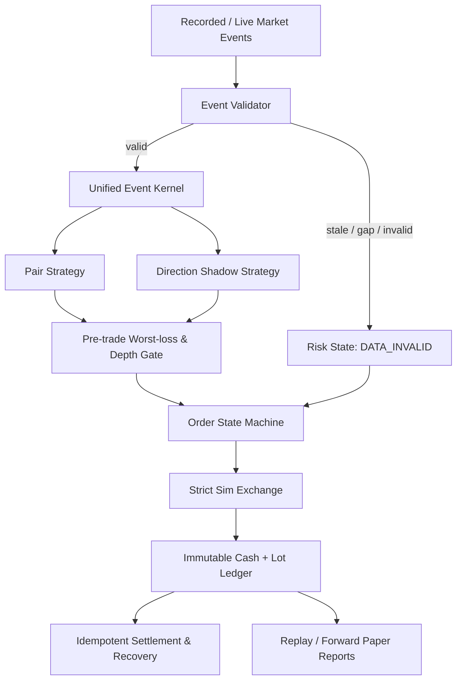

# PM-Quant v1.2 改进方案

> 状态：实施设计稿，尚未实施，未通过任何收益验证  
> 基线：v1.1 代码与 v1.0/v1.1 Paper 账本审计  
> 目标市场：Polymarket BTC 5 分钟 Up/Down 二元市场  
> 版本目标：**可信回放、可信 Paper、可证伪信号、硬风险边界**  
> 非目标：实盘上线、收益承诺、通过调参美化历史成绩

---

## 1. 一句话方案

v1.2 不再围绕 `BASE_EDGE`、凯利比例和补腿阈值做局部调参，而是按以下顺序重建：

**事件与数据可信度 → 撮合与账本可信度 → 回放与风险闭环 → 成交后概率优势 → 纯配对/方向策略分离验证 → 冻结参数向前 Paper。**

任何一层未通过，后续层级不得用“收益看起来不错”越级放行。

---

## 2. 版本边界与硬决策

### 2.1 v1.2 做什么

1. 修复 Paper 撮合、事件时序、账本、结算与恢复，使结果可重复、可审计。
2. 实现真正的历史回放，不再让 `sim/replay.py` 返回空结果。
3. 将当前混合逻辑拆成两个独立研究策略：
   - `pair_v1`：纯配对折扣策略；
   - `direction_shadow_v1`：带成交后优势验证的方向策略。
4. v1.2 默认以 `shadow` 模式运行新策略，只允许 Paper，不允许实盘下单。
5. 建立样本外、参数敏感性、成本敏感性、随机对照与容量验证门槛。

### 2.2 v1.2 不做什么

- 不承诺持续盈利或稳定增长。
- 不用历史收益最高的一组参数作为“最优参数”。
- 不用无交易窗口稀释亏损或提高胜率。
- 不把 Paper 盈亏称为真实资金收益。
- 不把双腿先后成交称为无风险套利。
- 不在概率未校准时启用凯利仓位。
- 不接入实盘交易所下单接口。

### 2.3 语义化版本约束

现有 `PLAN.md` 将“概率/效用模型重构”定义为主版本变化。为避免版本语义冲突：

- v1.2 只把新策略放在 **Shadow / Research** 路径，不替换已验证生产策略；
- 若后续通过全部研究门槛并正式替换核心策略，应封存为 **v2.0**；
- 若实施中决定直接在 v1.2 启用全新核心策略，则必须同步修改版本规范，不能名义 v1.2、实质 v2.0。

---

## 3. 保留、重写与删除清单

### 3.1 保留

- `core/` 与 `runtime/` 的决策/适配器边界。
- 单一事件驱动决策入口，Replay 与 Paper 共用策略代码。
- 报价滞回思想，避免微小价格变化频繁丢失队列优先级。
- maker/taker 共用费用函数的原则。
- 按版本隔离账本、代码快照和参数清单。
- 官方结算复核、原子写入和 Reduce-only 的设计方向。

### 3.2 重写

- `sim/matcher.py`：严格事件驱动、去重、深度约束、撤单在途。
- `sim/replay.py`：真实读取录制数据并输出确定性报告。
- `runtime/runner.py`：现金流水、持仓 lot、订单预留、幂等结算与恢复。
- `core/policy.py`：删除重复计价的效用比较，改为统一终值比较。
- `core/estimator.py`：将 TWAP 结算概率与通用波动率估计分离。
- `runtime/market_feed.py`：数据时间戳、来源、窗口归属与有效性门。
- `runtime/trade_stream.py`：成交事件唯一标识、去重、乱序与缺口处理。
- `core/circuit_breaker.py`：窗口最坏损失、日内权益高水位回撤、数据熔断。

### 3.3 删除或停用

- 无新成交时默认 `trade_volume=5.0` 的队列消耗。
- 使用陈旧 `last_trade_price` 反复生成新成交。
- taker 按最优价无限深度全量成交。
- 固定 `p_fill_maker=0.60`。
- `U_hold + p_fill * 全部配对利润` 的重复计价。
- 未校准概率驱动的 Kelly sizing。
- 将 `openPrice` 同时解释为窗口开盘价和实时价的路径。
- 用字符串匹配 `Decision.reason` 判断是否紧急撤单的隐式协议。

---

## 4. 目标架构



核心约束：

1. 决策只消费带时间戳和有效性标记的事件。
2. 订单状态变化只能通过事件推进，不能由每秒轮询伪造。
3. 策略、撮合、账本、结算各自可独立测试。
4. 任何异常默认进入不新开仓状态，而不是继续使用旧数据交易。

---

## 5. 工作包 WP0：冻结基线与数据治理

### 修改内容

- 将 v1.0/v1.1 原始账本视为只读实验资产，不修改、不重置、不覆盖。
- 新建 `data/2_ledgers/v1.2/`，与旧版完全隔离。
- 在 `manifest.json` 记录：
  - 代码 commit 或快照哈希；
  - 完整参数与配置哈希；
  - 数据集文件清单、大小、哈希与时间范围；
  - 回放入口、撮合口径、费用口径；
  - 样本内外切分点和样本外使用次数。
- 旧版只作为 `legacy_v1_1` 基线回放，不用于挑选新策略参数。

### 验收

- 同一配置与数据重复运行两次，报告哈希一致。
- 测试、回放、Paper 输出目录完全隔离。
- 任何报告都能追溯到代码、参数、数据和撮合版本。

---

## 6. 工作包 WP1：统一事件契约与数据有效性

### 6.1 标准事件结构

在 `core/types.py` 增加统一事件契约：

```text
MarketEvent
- event_id: 全局唯一标识
- slug / token_id / outcome
- kind: book / trade / oracle / settlement / heartbeat
- source_ts: 数据源事件时间
- receive_ts: 本地接收时间
- sequence: 可获得时的源序列号
- payload: 原始内容
- quality: VALID / STALE / GAP / OUT_OF_ORDER / DUPLICATE / INVALID
```

### 6.2 数据规则

- REST 订单簿失败、真实空簿、陈旧订单簿必须是三种不同状态。
- 所有价格必须绑定 `slug`、来源和来源时间；新窗口禁止复用未校验旧缓存。
- Binance 请求失败时不得把窗口 strike 当作实时价追加进历史。
- Polymarket 实时价格失效时明确回退到指定研究基线，并标记概率来源降级。
- WebSocket 重连后按 `event_id` 去重；缓冲区溢出必须记录缺口。
- 窗口切换时先处理旧窗口截止前全部有效事件，再冻结持仓和结算。

### 6.3 初始工程门限

以下仅作为初始安全值，实施后必须用实测延迟分布复核：

```text
BOOK_MAX_AGE_S = 2.5
ORACLE_MAX_AGE_S = 5.0
TRADE_STREAM_MAX_SILENCE_S = 按市场活跃时段校准，不统一硬编码
```

超过阈值：禁止新开仓；已有仓位只允许经过有效性检查的减仓动作。

### 验收

-  stale、重复、乱序、缺口、跨窗口事件均有单元测试。
- 数据无效时策略不能生成新首腿。
- 同一事件重复消费不会改变队列、持仓或现金。

---

## 7. 工作包 WP2：重写撮合与订单状态机

### 7.1 订单状态

```text
NEW -> LIVE -> PARTIALLY_FILLED -> FILLED
              |-> CANCEL_PENDING -> CANCELLED
              |-> REJECTED / EXPIRED
```

`CANCEL_PENDING` 期间订单仍可成交；只有收到模拟撤单确认后才停止撮合。

### 7.2 Maker 规则

- 没有新成交事件，队列不变化。
- 陈旧 `last_trade_price` 不参与撮合。
- 只有订单生效后的新事件才能扣减队列或成交。
- 同价位 print 可按成交量扣减 `queue_ahead`。
- 低于买单价格的 print 不默认将其全部成交量视为经过本档位；缺少档位分解时必须采用保守假设并单列敏感性。
- 穿价成交受可见对手方深度限制，支持部分成交。
- 重连、去重、窗口切换不能重复扣队列。

### 7.3 Taker 规则

- 按订单尺寸遍历盘口多档，计算实际 VWAP。
- 深度不足只产生部分成交，剩余部分按 IOC/FOK 规则取消或继续等待。
- 费用按实际各档成交价格与数量计算。
- 下单延迟期间盘口可变化，禁止使用决策时刻价格无滑点成交。

### 7.4 三种研究口径

每次回放至少输出：

1. `standard`：经数据校准的队列与延迟假设；
2. `pessimistic_queue`：100% 队尾、保守穿价扣量、撤单在途；
3. `stress_execution`：更深滑点、部分成交和一腿失败情景。

### 验收

重点测试：

- 无 print 不成交；
- 旧 print 不成交；
- 重复 trade ID 不成交；
- 订单生效前不成交；
- 撤单在途可成交；
- 深度不足只能部分成交；
- 低价 print 不被当作本档全部成交量；
- 同一回放事件序列结果完全确定。

---

## 8. 工作包 WP3：账本、资金与结算重做

### 8.1 分离三类记录

1. **不可变现金流水**：买入、卖出、手续费、兑付、结算修正。
2. **残余持仓 lot**：每笔未配对成交的数量和真实成本。
3. **已配对库存**：锁定配对数量与配对净损益，不再参与残余方向决策。

禁止继续使用“净现金流 ÷ 剩余股数”作为后续交易的成本基础。

### 8.2 真实资金口径

```text
free_cash = settled_cash - open_order_reserve - unsettled_liability
equity = settled_cash + executable_liquidation_value + expected_settlement_receivable
```

- `max(10, 100 + total_pnl)` 不得再作为资金下限。
- 新开仓、taker 补腿和 unwind 全部经过同一资金检查。
- 看板的 turnover 改为所有成交的 `abs(price * size)` 之和，手续费另列。

### 8.3 幂等结算与恢复

结算状态：

```text
OPEN -> PROVISIONAL -> OFFICIAL_PRICE_CONFIRMED
     -> GAMMA_VERIFIED -> RECONCILED
```

- 每个 `slug + settlement_revision` 只能记账一次。
- 待复核结算持久化，重启后自动恢复，不得只在内存保存。
- 官方结算修正后，同步重算累计 PnL、日度风险、连亏与冷却状态。
- 中途停止或崩溃后恢复当前窗口持仓、订单、成交游标和待结算状态。

### 验收

- 现金守恒：所有盈亏均能逐笔解释。
- 重复调用关窗不会重复增加 PnL。
- 结算修正不会留下旧风控状态。
- 重启前后订单、持仓、现金、成交游标一致。

---

## 9. 工作包 WP4：建立真正风险边界

### 9.1 盘前最坏损失门

对任何拟执行动作，分别计算结算为 Up 和 Down 的最终 PnL：

```text
worst_final_pnl = min(pnl_if_up, pnl_if_down)
```

同时计算“假设所有暴露挂单均成交”后的最坏结果。只有满足以下条件才允许新开仓：

- 最坏结算损失不超过窗口风险预算；
-  free cash 足够；
- 深度与参与率不越界；
- 数据全部有效；
- 策略本身处于启用状态。

### 9.2 风险状态

```text
NORMAL
REDUCE_ONLY
DATA_INVALID
HALTED
```

触发规则：

- `worst_final_pnl` 超过单窗口预算：禁止新增风险，进入 `REDUCE_ONLY`。
- 日内权益高水位回撤超过预算：进入 `HALTED`，需要人工复核恢复。
- 数据陈旧或缺口：进入 `DATA_INVALID`，禁止新开仓。
- 账本不一致、重复结算、恢复失败：立即 `HALTED`。

### 9.3 退出决策

hold、maker hedge、taker hedge、unwind 必须使用同一终值框架：

```text
U_maker = (1 - lambda_fill) * U_unfilled + lambda_fill * U_paired
```

其中 `lambda_fill` 来自队列与历史成交率估计，不得固定为 0.60。

taker hedge 与 unwind 可以使用负效用，但只表示“减少更差结果”，不得在报告中记为套利利润。

### 9.4 仓位原则

- v1.2 研究阶段停用 Kelly。
- 方向策略只允许最小固定研究单位，并限制最大残余股数。
- 配对策略尺寸由可执行深度、一腿失败损失和窗口预算共同决定。
- 不以加仓摊低首腿成本作为恢复盈利的手段。

---

## 10. 工作包 WP5：策略分离与概率重建

### 10.1 策略 A：`pair_v1`

纯配对策略不先主动承担方向首腿。

对同一数量 `n`，从双边真实卖档计算：

```text
pair_edge(n) = n
             - executable_cost_up(n)
             - executable_cost_down(n)
             - taker_fees(n)
             - slippage_buffer(n)
             - leg_in_failure_reserve(n)
```

只有 `pair_edge(n)` 大于预设最低净折扣，且数据、深度、资金和风险门全部通过，才生成配对意图。

执行约束：

- 若交易接口支持 IOC/FOK，按其实际语义模拟双腿执行；
- 不得假设不存在原子双腿接口时仍能同时无风险成交；
- 一腿成交、另一腿失败必须进入独立 leg-in 处置流程；
- 一腿失败成本必须计入策略历史，而不是作为账外异常。

### 10.2 策略 B：`direction_shadow_v1`

方向策略先在 Shadow 中运行，不自动继承 v1.1 的开仓权限。

概率目标改为真实结算事件：

```text
X = TWAP_close - TWAP_open
p_model(t) = P(X > 0 | information_available_at_t)
```

若收盘 TWAP 已部分观察，应分别处理已观察部分和剩余未来价格权重；接近到期时不能简单将概率硬跳到 0.99/0.01。

数据优先级：

1. Chainlink/官方结算源历史序列用于建模结算变量；
2. Binance 现货可作为预测特征，但不能未校准就替代结算源；
3. 市场盘口隐含概率作为强基准，模型需证明相对基准的增量信息。

### 10.3 成交后优势

方向策略必须估计：

```text
EV_entry = E[p_win | my_order_fills, price, queue_state, market_state]
         - execution_price
         - all_costs
```

同时输出：

- 报价时与成交时的概率差；
- 成交后 1s / 5s / 30s / 到期 markout；
- 按剩余时间、波动率、距 strike 距离分层的校准；
- Brier score、log loss、可靠性图；
- 与纯市场隐含概率基准的差异。

若模型不能稳定优于市场基准，或成交后优势被逆向选择抵消，方向策略直接停止，不继续调参。

---

## 11. 工作包 WP6：真实回放与研究报告

### 11.1 回放实现

`sim/replay.py` 改为：

- 从实际 `data/1_market/events/`、`oracle/`、`settlements/` 读取；
- 按 `source_ts / receive_ts / event_id` 确定性排序；
- 使用与 Paper 相同的策略、订单状态机和账本；
- 数据缺口只记录，不插值伪造；
- 支持按日期、窗口、版本和撮合口径批量运行。

### 11.2 每次报告必须包含

```text
data/3_reports/v1.2/<run_id>/
- manifest.json
- metrics.json
- windows.csv
- fills.csv
- edge_decomposition.csv
- calibration.csv
- capacity.csv
- summary.html
```

### 11.3 收益分解

至少拆成：

- 配对折扣；
- 未配对方向盈亏；
- maker/taker 费用；
- 买卖价差与滑点；
- 逆向选择；
- 一腿失败处置成本；
- unwind 成本；
- 结算修正。

报告同时列出总窗口、有交易窗口和无交易窗口，禁止混用分母。

---

## 12. 样本外与反过拟合协议

### 12.1 数据切分

- 按连续时间切分 train / validation / test，不随机打散 5 分钟窗口。
- 初始目标至少覆盖 30 个自然日，并包含不同波动状态；不足则继续采集。
- test 默认只使用一次；每次查看 test 后再次改参，必须登记使用次数并重新收集独立 forward 数据。
- 不能用大量无交易窗口凑样本量，统计显著性以有交易窗口和实际成交为基础。

### 12.2 必做四件套

1. **样本外**：明确切分点、使用次数、各 regime 表现。
2. **参数敏感性**：邻域网格，不接受单点参数孤岛。
3. **随机与蒙特卡洛对照**：按日 block bootstrap、随机交易基准、Deflated Sharpe，并登记尝试策略与参数组合数。
4. **成本敏感性**：费用、滑点、队列悲观程度至少放大 1.5x / 2x / 3x。

### 12.3 容量

- taker 订单尺寸相对可执行深度的参与率初始不超过 10%，后续只能依据实测冲击校准。
- maker 报告队列位置、等待时间、实际成交率和撤单在途成交率。
- 容量结论必须基于部分成交后的净收益，而非顶档名义价格。

---

## 13. v1.2 放行门槛

### Gate 0：代码与数据完整

- 所有单元测试通过，重复测试方法名问题修复。
- 旧测试中“低于挂单价的 print 可全量成交”等错误假设被替换，而不是继续固化。
- 测试不会写入正式账本。

### Gate 1：回放可信

- 同输入重复回放结果一致。
- 无默认成交、无陈旧 print 成交、无无限深度 taker。
- 结算、重启、去重、撤单在途、窗口切换测试全部通过。

### Gate 2：信号有效

- 概率校准有样本外证据。
- 方向策略证明成交后仍有优势；否则永久停留在禁用状态。
- 多重检验校正后仍有效，不能只报告最优组合。

### Gate 3：经济期望成立

- 悲观队列口径下，有交易窗口净均值 95% 置信区间下界大于 0。
- 1.5x 成本下置信区间下界大于 0；2x/3x 结果完整披露。
- 去掉前 1% 最盈利交易后仍保持正净收益。
- 收益不能主要来自单腿残留或结算口径错误。

### Gate 4：风险与容量成立

- 所有窗口的最坏结算损失均在预设预算内。
- 日内高水位回撤包含未实现盈亏。
- 一腿失败、流动性消失、数据中断、重启恢复均有通过记录。
- 深度参与率和容量满足当前 Paper 资金规模。

### Gate 5：向前 Paper

- 冻结代码、参数和数据口径后运行预设 forward 周期，初始不短于 14 个自然日；成交样本不足则延长。
- 不回改 frozen test，不通过删除亏损窗口改善结果。
- 实际成交率、配对率、单腿损失、费用和净 PnL 与回放一致或差异可解释。

**任一 Gate 不通过：保持 Shadow 或停止策略，不进入下一阶段。**

---

## 14. 文件级实施清单

| 文件 | v1.2 动作 |
|---|---|
| `config.py` | 版本切为 v1.2；新增模式、数据有效性、研究与风控配置；移除默认 Kelly 启用 |
| `core/types.py` | 标准事件、订单状态、现金流水、持仓 lot、配对库存、风险状态 |
| `core/estimator.py` | 保留通用统计工具；结算概率迁移到独立模型 |
| `core/probability.py` | 新增 TWAP 结算概率、校准与市场基准接口 |
| `core/policy.py` | 统一终值比较；路由 pair 与 direction；删除重复计价 |
| `core/risk.py` | 新增盘前最坏损失、深度、资金与数据门 |
| `core/execution.py` | 显式紧急撤单枚举；真实队列等待配置接线；统一尺寸约束 |
| `core/circuit_breaker.py` | 高水位权益回撤、未实现盈亏、持久化状态 |
| `sim/matcher.py` | 按 WP2 全面重写 |
| `sim/replay.py` | 实现真实事件回放与报告输出 |
| `runtime/market_feed.py` | 修复实时价语义、时间戳、缓存窗口归属、数据有效性 |
| `runtime/trade_stream.py` | 唯一 ID、去重、乱序、缺口与旧窗口事件处理 |
| `runtime/runner.py` | 现金/lot 账本、资金预留、幂等结算、快照恢复 |
| `runtime/pipeline.py` | 统一事件时序；先处理旧窗口事件再结算；新策略默认 Shadow |
| `web/server.py` / `web/static/` | 区分 Replay/Paper；展示数据质量、残余风险、成本分解，不突出虚假精度 |
| `tests/` | 新增事件、撮合、账本、恢复、TWAP、风险、回放确定性测试 |

---

## 15. 最小测试矩阵

1. 无新 print 时 maker 永不成交。
2. 陈旧 last trade 不扣队列。
3. 重复 trade ID 只消费一次。
4. 订单生效前的事件不成交。
5. cancel pending 期间可以成交。
6. taker 深度不足只部分成交并计算 VWAP。
7. 低价 print 不默认全量扣减本档队列。
8. 现金流水与持仓 lot 始终守恒。
9. unwind 后残余 lot 成本不被卖出收入污染。
10. 重复关窗不重复记 PnL。
11. 结算修正同步更新风控状态。
12. 重启后当前窗口与待结算状态完整恢复。
13. 数据陈旧时禁止新开仓。
14. TWAP 开盘、部分观察、收盘边界计算正确。
15. maker 补腿效用不重复计算持有收益。
16. 最坏结算损失超预算时动作被拒绝。
17. 日内高水位回撤包含未实现损失。
18. 回放两次产生相同报告哈希。
19. 旧窗口截止前事件先处理再结算。
20. 所有测试只写临时目录。

---

## 16. 实施顺序与回滚

### 阶段 M0：封存

- 封存 v1.1 基线、账本与问题清单。
- 新功能全部由显式开关控制，初始 `STRATEGY_MODE=shadow`。

### 阶段 M1：可信基础设施

- 完成 WP0-WP4。
- 此阶段不追求策略盈利，只追求结果可重复、现金可解释、风险可限制。

### 阶段 M2：研究策略

- 完成 `pair_v1` 与 `direction_shadow_v1`。
- 旧策略仅作基线，不与新策略混合开仓。

### 阶段 M3：回放验证

- 完成四件套、容量和压力测试。
- 未通过即删除或继续 Shadow，不做参数堆砌。

### 阶段 M4：冻结向前 Paper

- 通过 Gate 0-4 后冻结配置，运行 Gate 5。
- 看板只展示冻结版本结果。

### 回滚原则

- 发现现金不守恒、重复结算、陈旧数据开仓或尾部损失越界：关闭策略开关并进入 `HALTED`。
- 回滚不意味着恢复已知有缺陷的 v1.1 撮合继续交易，而是停止新交易、保留只读看板和数据恢复能力。
- 旧账本永不因回滚被修改或删除。

---

## 17. v1.2 完成定义

v1.2 的完成不代表“开始赚钱”，而代表以下事实全部成立：

1. 同一历史数据可以重复得到同一结果；
2. 每笔 Paper 成交都有真实事件依据和深度约束；
3. 每笔盈亏都能由现金流水和持仓 lot 解释；
4. 任意新开仓都有最坏损失、资金、数据和容量门；
5. 纯配对与方向策略的收益来源被分开验证；
6. 负期望或无证据的策略能够被系统自动停用；
7. 冻结参数后的向前 Paper 可以被独立复核。

**最终质量门结论：当前仅为实施计划，不放行实盘，不预设策略正期望。v1.2 最重要的能力是“没有优势时不交易”，而不是“任何行情都保持交易频率”。**
